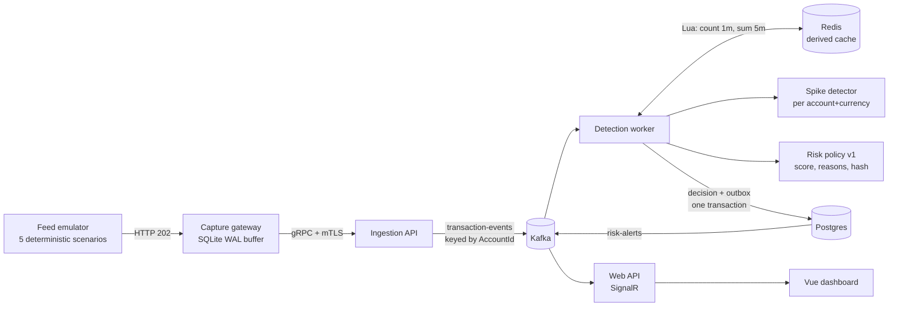

# TxMonitoringPlatform

Near-real-time **transaction risk monitoring** in .NET 10. A synthetic feed of outbound debit
attempts flows through a durable capture pipeline into Kafka, where a detection worker scores
every transaction with an explainable, versioned risk policy: per-account amount spikes plus
Redis sliding-window velocity (count per minute, sum per five minutes) in integer minor units.
Each decision is persisted with its reason codes, and review-recommended alerts reach a Vue
dashboard. The focus is risk rules you can audit, a cache that can fail without losing a
transaction, and a measured gateway-to-decision latency.

> Origin: this repo began as a copy of
> [IndustrialPlatform](https://github.com/chris-straka/industrial-telemetry-platform) (IoT
> telemetry, ML.NET anomaly detection, AI diagnosis), re-themed for fintech. The capture
> gateway, outbox, and DLQ mechanics are shared lineage and explained there; the feed, risk
> policy, velocity cache, money types, and detector provenance are specific to this repo, and
> there is no LLM anywhere in the decision path.



It **observes** a transaction feed. It never moves, holds, authorises, captures, clears,
settles, refunds, or reconciles money; it keeps no balances, blocks nothing, and returns no
approve/decline decision. It is not a ledger and not a payments system. (Note: "capture" here
means capture of an **event feed**, not the payments operation of requesting settlement after
an authorisation — this project never performs that operation.)

One v1 event is one immutable observation of a synthetic outbound debit attempt:
`MessageId`, `AccountId`, `SequenceNumber`, `OccurredAt`, `AmountMinor`, `Currency`.
`AmountMinor` is the attempted debit amount in **integer minor units** — no floats anywhere in
the money path. Approval, decline, posting, reversal, and settlement outcomes are absent, so
credits, refunds, and declines must stay out of these velocity totals. `AccountId` is an
account-scoped monitoring key, not a customer identity: activity spread across multiple
accounts cannot be correlated.

Docker Compose is the supported runnable/demo path. The Helm chart and Terraform stack render,
lint, and plan cleanly but have never been applied to a real cluster: do not present them as a
production deployment.

# Quickstart

Docker and Make are the only requirements for the demo path.

```sh
git clone https://github.com/chris-straka/TxMonitoringPlatform.git
cd TxMonitoringPlatform
make upd
```

The dashboard is at <http://127.0.0.1:5173> and Grafana at <http://127.0.0.1:3000>. Give the
pipeline a few seconds to produce its first transactions, then see [The demo](#the-demo) to
take ingestion down and watch the capture buffer absorb the outage.

No API keys or `.env` file are needed: risk decisions are deterministic and computed by
detection, with no external LLM call anywhere in the path.

> **One-time volume reset.** The target release is a clean cutover, not a compatible upgrade:
> industrial payloads, topics, tables, and volumes cannot be migrated honestly. If an old
> checkout's volumes exist on this machine, discard **only this project's** demo data with
> `docker compose down --volumes` before the first run. Never run that against an unverified
> project context.

# Build and test

```sh
dotnet build TxMonitoringPlatform.slnx && dotnet test TxMonitoringPlatform.slnx      # 120 tests
cd src/TxMonitoring.Web.Dashboard && npm ci && npm run lint && npm test && npm run build  # 25 tests
./scripts/e2e.sh                                                                    # needs Docker
```

On Apple Silicon without Rosetta, `brew install protobuf grpc` provides the native `protoc` that
`Directory.Build.props` picks up. Node is pinned to 24 LTS in `mise.toml`.

# Results

Measured on an Apple M4 Mac mini (10 cores, 16 GB), .NET 10.0.401, Release build, on
2026-10-05 while other builds were running on the machine, unless noted.

Scenario replay: each generator scenario's own amount schedule and cadence goes through the
production spike detector and risk policy, with velocity windows computed as the Redis Lua script
computes them (4 accounts x 600 events, seeded, warm-up excluded).
Command: `dotnet test tests/TxMonitoring.Detection.Tests -c Release --filter ScenarioReplayTests --logger "console;verbosity=detailed"`.

| scenario | review | absolute | spike | count 1m | sum 5m |
| --- | --- | --- | --- | --- | --- |
| Steady | 0.0% | 0.0% | 7.1% | 0.0% | 0.0% |
| HighAmount | 100.0% | 100.0% | 5.6% | 0.0% | 100.0% |
| AccountSpike | 0.0% | 0.0% | 8.4% (196/196 scheduled spikes) | 0.0% | 0.0% |
| Burst | 87.3% | 0.0% | 5.6% | 100.0% | 86.5% |
| Combined | 99.8% | 10.0% | 10.0% | 100.0% | 99.8% |

What it shows: the per-account detector's tail fires on about 7% of steady traffic, but a lone
signal scores 40 against a review threshold of 60, so steady flow never alerts. Burst reviews
once the five-minute sum fills. The replay also corrected a documented claim: HighAmount was
described as "absolute rule alone, no alert", but four $3,000+ debits in five minutes pass the
$10,000 sum rule, so the scenario reviews every time.

| what | result | command |
| --- | --- | --- |
| Policy evaluation, in-process | ~1.05M decisions/s (median of 5 runs, range 0.56M-1.17M) | `dotnet test tests/TxMonitoring.Detection.Tests -c Release --filter PolicyThroughputTests --logger "console;verbosity=detailed"` |
| Gateway-to-decision latency, healthy 20-transaction batch through gateway, Kafka, detection, Postgres, Redis | 0.8 s avg, 1.3 s max | `./scripts/e2e.sh` (owner run, 2026-09-16; **not re-run on 2026-10-05** because Docker was down) |
| Test suites | 120 .NET + 25 Vue, all passing | commands above |
| Dashboard bundle | 581 kB raw / 209 kB gzip | `npm run build` |

The latency number has a story worth knowing: the first run said 62 s, because the e2e harness
never started Redis and every decision waited out reconnect timeouts before degrading. See
[docs/Interview.md](docs/Interview.md).

A guided tour with exercises and interview answers is in [docs/LEARN.md](docs/LEARN.md).

# Data flow

```
feed-emulator (N accounts, mints MessageId + SequenceNumber + OccurredAt)
                          │ HTTP/JSON, LAN
                          ▼
   ┌────────────────── capture-gateway ───────────────────┐
   │  receiver ──► SQLite (WAL, synchronous=FULL)         │
   │                    │                                 │
   │                    ▼                                 │
   │              uploader ──► oldest-first, batched      │
   │                                                      │
   │  + bounded buffer w/ 429 + Retry-After backpressure  │
   │  + exponential backoff w/ jitter                     │
   │  + OTel: queue depth, oldest transaction age         │
   └────────────────────────┬─────────────────────────────┘
                            │ gRPC unary, up to 200 transactions a call (HTTP/2 + mTLS), WAN
                            ▼
                       ingestion-api
                            │ produces transaction-events, keyed by AccountId
                            ▼
   ┌───────────────────── Kafka ────────────────────────┐
   │                        ▲                           │
   ▼                        │                           ▼
detection-worker            │                       web-api
 ├─ replays on MessageId    │                        ├─ consumes transaction-events
 ├─ amount spike check      │                        ├─ consumes risk-alerts (own group)
 ├─ Redis velocity windows  │                        └─ relays live data via SignalR
 ├─ policy: score + reasons │                                   │
 ├─ saves to Postgres       │                                   ▼
 ├─ poisons ──► transaction-events-dlq                  web-dashboard
 └─ alert outbox publisher ─┘
```

# Input facts versus decisions

The feed produces **facts**: identity, account, sequence, event time, amount, currency (`CAD`
in v1). Detection derives everything else:

- deterministic heuristic `RiskScore` (0–100) and `ReviewRecommended`;
- stable reason codes in fixed rule order, each with metric, observed value, threshold, points;
- raw per-account spike-detector score, p-value, history count, artifact version;
- velocity evidence (`Count1m`, `Amount5mMinor`) plus availability status;
- risk-policy version and content-derived policy configuration hash.

`RiskScore` is a transparent demo-policy ranking, **not** a calibrated fraud probability, and
`ReviewRecommended` means "emit a monitoring alert", not "fraud occurred". There is no case
queue, assignment, disposition, or regulatory-review workflow in v1.

The detector is an online per-account IID spike baseline over a `log(1 + AmountMinor)`
feature — keyed state with warm-up and recovery, not a trained fraud model. The policy rules
are illustrative demo thresholds (`amount.absolute_high`, `amount.account_spike`,
`velocity.count_1m`, `velocity.amount_5m`), not production defaults. Correlated rules share a
family cap so combined evidence still alerts when Redis is down or when no amount spike fires.

# Delivery guarantees

The gateway's `202` splits the pipeline into two reliability zones.

Before it, delivery is best-effort. The feed emulator is a load generator, not a system of
record: a full in-memory channel drops the new transaction, and a dequeued item that never
receives the exact `202` after bounded retries is discarded. Separate metrics
(`feed.transaction.dropped`, `feed.transaction.delivery_dropped`) count both. Nothing upstream
of the gateway's `202` claims custody, so this leg is never described as at-least-once.

After it, custody and retry are durable. The gateway commits the valid transaction to SQLite
(WAL + `synchronous=FULL`) before returning `202`, retains the row until ingestion names its
`MessageId` accepted or permanently rejected, and deletes only IDs ingestion explicitly names.
IDs in neither response list stay queued, so transient Kafka/producer failures never become
rejections. Kafka delivery and the detection consumer are at-least-once: detection commits an
offset only after Postgres succeeds, an exact duplicate is verified, or a poison record is
durably copied to `transaction-events-dlq` first. Postgres has a unique `MessageId` index, so
a Kafka replay is a no-op row-wise; the alert outbox keeps at-least-once publishing with
`MessageId` as the dashboard dedupe key.

A deterministic ingestion rejection is permanent loss from the live pipeline, not successful
delivery. The gateway atomically preserves the original row in a bounded SQLite quarantine
before settling it; inspect recent entries at `GET /buffer/quarantine?limit=100`. Same ID with
different immutable content is a 409 conflict that preserves the original; a quarantined retry
returns the stable terminal 422.

The pipeline carries three clocks so an outage stays measurable:

| field | whose clock | meaning |
| --- | --- | --- |
| `OccurredAt` | feed origin | when the attempt happened (event time) |
| `ReceivedAt` | ingestion | stamped once per Kafka publication attempt (delivery metadata) |
| `DetectedAt` | detection | when the decision was created |

Without `OccurredAt`, transactions drained after a 30 minute outage would all claim to have
happened in the seconds it took to flush the queue. `ReceivedAt` may move on retry after a
lost ACK; the first durable Postgres row wins.

A monotonic per-account `SequenceNumber` makes gaps inside a generator run visible. The feed
resets it on restart and can drop transactions before `202`, so a Postgres-only count is an
audit signal rather than proof of the downstream guarantee or of an unseen tail.

# Redis is a cache, never custody

Redis holds sliding-window velocity counters per `(AccountId, Currency)`, observed atomically
with a checked-in Lua script. It is derived state:

- ingestion, Kafka consumption, and the Postgres write never depend on Redis being up;
- when Redis is unreachable, detection persists the decision with `VelocityStatus` Unavailable
  (never zero counts), increments `detection.velocity.unavailable`, and continues — offsets
  still progress, nothing is rewound or sent to the DLQ for it;
- windows rebuild lazily from recent Postgres rows after an outage; recovery repairs state used
  by **future** decisions and never rescores the outage period.

Losing Redis loses accuracy for a window, never a transaction.

# The demo

```sh
make demo-help          # prints the whole script
make upd                # everything up, queue depth ~0
make chaos-cloud-down   # kill ingestion; queue climbs, feed keeps generating
make chaos-gateway-kill # kill the gateway too, mid-outage; buffer survives
make chaos-cloud-up     # ingestion returns; queue drains oldest-first
make verify             # briefly quiesce the feed, drain the pipeline, audit IDs/gaps/lag
```

Watch `capture_queue_depth` and `capture_oldest_transaction_age_seconds` in Grafana while it
runs. The audit temporarily stops any active Compose feed containers, waits for the capture
queue, detection consumer lag, and alert outbox to drain, takes a stable snapshot, then
restarts the feed containers that were running. It fails on an empty database, duplicate IDs,
or a pipeline that does not drain before the timeout.

The feed generates deterministic scenarios from `Generator__Scenario` (`Steady`, `HighAmount`,
`AccountSpike`, `Burst`, `Combined`): steady flow stays below every velocity threshold after
warm-up, and each other scenario exercises a named rule or combination.

For an automated destructive test that does not touch the normal development project:

```sh
./scripts/e2e.sh
```

The isolated Compose harness verifies an ingestion outage plus gateway restart, Postgres
consumer retry, malformed-record DLQ handling, alert-outbox recovery after a Kafka outage, and
rejection of a TLS client that does not present the gateway certificate. It uses a unique
Compose project and volumes on every run.

# Health and local transport security

The gateway, ingestion, detection, and web services expose `/health` for process liveness and
`/health/ready` for the dependencies needed to accept new work:

| component | readiness means |
| --- | --- |
| capture gateway | local SQLite queue is writable |
| ingestion | required Kafka topics/partitions are available |
| detection | Kafka topics/assignment, Postgres, and current migrations are available |
| web API | Kafka topics and consumer assignment are available |
| Redis | never gates readiness; degradation is metrics/logs |

Ingestion reachability is a gateway metric rather than gateway readiness: accepting onto local
disk during an ingestion outage is its job.

Compose generates a private development CA, an ingestion server certificate, and a gateway
client certificate in separate named volumes. The gateway validates the ingestion name and
private CA; ingestion requires the client certificate, validates its client-auth purpose and
private CA, and checks its SHA-256 fingerprint against an allowlist. Identities survive
ordinary restarts, while `docker compose down -v` intentionally destroys and regenerates this
local PKI.

This mTLS protection covers only gateway-to-ingestion gRPC. Feed-to-gateway, Kafka, Postgres,
Redis, and observability traffic remain plaintext and unauthenticated inside the Compose
network. The dashboard has no production authentication or case-level access control. See
[Security](docs/Security.md) for the exact boundary and remaining work.

# Install

To run the demo:

- [docker](https://www.docker.com/)
- [Make](https://www.gnu.org/software/make/)

To build and test outside Compose:

- [.NET](https://dotnet.microsoft.com/en-us/download) for `make test` and the individual services
- [Node](https://nodejs.org/en) for the dashboard's Vite dev server

For the prototype deployment material, which renders and plans but has never been applied:

- [tilt](https://tilt.dev/)
- [Terraform](https://developer.hashicorp.com/terraform/install)

# Ports

Compose publishes development ports on `127.0.0.1` only.

| service | host port | notes |
| --- | --- | --- |
| web-dashboard | 5173 | Vite dev server |
| web-api | 5090 | SignalR hub (`/riskHub`) |
| ingestion-api | 5089 | health probes only; no debug bypass |
| ingestion-api | 5091 | gRPC (HTTPS/HTTP/2); requires the gateway client certificate |
| capture-gateway | 5272 | feed receiver, `/health`, `/health/ready`, and buffer inspection |
| detection-worker | 5265 | local run only; health probes |
| redis | 6379 | ephemeral velocity cache; no persistence volume |
| grafana | 3000 | anonymous viewer; provisioned dashboard, alerts, logs, metrics, and traces |
| kafka-ui | 8080 | |
| pgadmin | 5050 | |

# Notes

Design notes live in [docs/](docs/): [Networking](docs/Networking.md),
[Kafka](docs/Kafka.md), [Observability](docs/Observability.md), [Postgres](docs/DB/Postgres.md),
[SQLite](docs/DB/SQLite.md), [MLOps](docs/ML/MLOps.md), [Fintech](docs/Fintech.md), and
[Security](docs/Security.md). Known gaps and planned work are in
[TODO.md](TODO.md).

Docker Compose is the supported runnable/demo path. The checked-in Helm and Terraform material
can be linted, rendered, or planned, but it has not been applied and exercised as a production
system. See the remaining deployment work in [TODO.md](TODO.md) before treating it as
deployable infrastructure.
